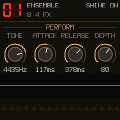

<p align="center"></p>

# Shine On

**A string ensemble for the M-VAVE FM-1, with a three-line ensemble, a phaser, delay and a plate reverb.**

Shine On turns the FM-1 into one of the string machines of the seventies: every key has its own keyer, the tone
comes from phase-locked footages (16', 8', 4' sawtooth and an 8' square, as a top-octave divider gives them), and
the six registers are fixed formant filters on the sum, not filters per voice: CONTRABASS and CELLO (the bass
section), VIOLA, VIOLIN, TRUMPET and HORN. Then TONE, WARMTH, BRIGHT and the part that makes the sound: three
bucket-brigade lines swayed by two LFOs 120 degrees apart. 16 voices, 32 factory programs (99 slots), an
arpeggiator, a two-track step sequencer with a sound of its own on track B, all from
[OberVave](https://github.com/zvenson/obervave), whose panel, sequencer, delay and reverb this is.

<p align="center"></p>

> **Status: 1.2.3, built for the FM-1 (identity `FM-1_962`), tested on the host, in the browser and on an FM-1.** Install it from
> [thefirmwarehub.com](https://thefirmwarehub.com) or with `tools/fm1_install.py docs/firmware/shineon-1.2.3.fwsc`.
> 1.2.3: the update loader shows what it does (UPDATE MODE with a running light while it waits, WRITING with 20 segments
> and the percent, UPDATE FAILED), in the Firmware Hub's look, as OberVave's; the idea from Skiff. 1.2.2 opened the FM-1's **TRS MIDI IN** jack: a keyboard, a drum machine or a sequencer through a TRS-to-DIN adapter
> plays Shine On (notes, CC, program change, clock, start / stop; if nothing plays, try the other adapter type, A or B).
> Before, only USB-MIDI reached it. The keys now send their notes on the MIDI channel set (they always went out on
> channel 1).

**Play it in your browser:** `docs/sim/` is the firmware itself (the same C sources, compiled to WebAssembly) with
the FM-1's screen, keys, buttons and knobs, your computer keyboard or a MIDI keyboard. Build it with
`sh web/sim/build.sh`, try it with `python3 -m http.server -d docs/sim`.

## The sound

| | |
| --- | --- |
| **Keyers** | 16. Each key its own attack (CRESCENDO on the originals) and release (SUSTAIN LENGTH), analog RC curves 0.5 ms to 10 s, a little velocity if you want it (the originals had none), GLIDE. |
| **Footages** | Per keyer a 16', 8' and 4' sawtooth and an 8' square, phase-locked as a divider's (PolyBLEP anti-aliased). OCTAVE shifts the whole sound. |
| **Registers** | Fixed formant filters on the summed footages: CONTRABASS (16', round), CELLO (8', warm with a 400 Hz body), VIOLA (8', nasal, a 1.2 kHz formant), VIOLIN (4', bright and airy), TRUMPET (8' square, a 1.5 kHz band), HORN (8' square, hollow). SPLIT puts the bass section under a key of your choice, as the originals' lower manual; off, every register plays the whole keyboard. |
| **Tone** | TONE (a 12 dB low-pass over the lot, CC 74), WARMTH (a gentle tanh), BRIGHT (a presence lift above 3 kHz). VINTAGE: a few cents a keyer and a slow drift. |
| **Vibrato** | A triangle per sound with rate, depth and a delay; the mod wheel (CC 1) adds to it. |
| **Ensemble** | Three lines on one bucket brigade, swayed by a slow LFO (0.6 Hz, up to +-4 ms) and a fast one (6 Hz, a tenth of that), three phases 120 degrees apart, 4-point Hermite reads. MONO as the originals (one output), STEREO (line 1 left, 3 right, 2 in the middle), WIDE. RATE scales both LFOs, MIX down to the dry divider. |
| **Phaser** | Six allpass stages a side, the right a quarter turn behind the left, 0.05 to 4 Hz, feedback: the pedal every string machine was played through. |
| **Delay, reverb** | OberVave's: a ping-pong delay in note values of the tempo with a tape-like slew, Dattorro's plate at the full sample rate. |
| **Arpeggiator** | UP, DOWN, UP/DN, RANDOM, AS PLAYED; 1-4 octaves; 1/4 to 1/32 with triplets; gate; latch (HOLD). One per sound. Follows MIDI clock. |
| **Sequencer** | OberVave's: two tracks that share 256 steps, chords of four, velocity, gate and ties, ratchets, chance, polymeters, swing, 8 patterns in flash; track B with a sound of its own. |
| **MIDI** | USB-MIDI in and out; the FM-1's TRS MIDI IN jack (3.5 mm, through a TRS-to-DIN adapter, type A or B). Notes, velocity, pitch bend, program change, sustain, mod wheel, clock / start / stop, MIDI channel or OMNI (channel + 1 plays track B's own sound). CC 74 tone, 73 / 72 attack / release, 5 glide, 1 mod depth, 7 volume, 64 sustain, 120 / 123 all off; every other parameter from CC 20 up in the order of the parameter table (`firmware/src/shn_params.h`). |

Integers only: the chip has no FPU. The whole engine is fixed point, the tables are generated by
`tools/gen_tables.py` and committed.

## The pages

**HOME** PERFORM (TONE, ATTACK, RELEASE, ensemble DEPTH). **EDIT** STRINGS (the four string registers) / BRASS +
SPLIT / TONE (TONE, WARMTH, BRIGHT, VELOCITY). **ENV** KEYER (ATTACK, RELEASE, VELOCITY, GLIDE). **LFO** VIBRATO.
**ARP** the arpeggiator (on its page the ARP button is HOLD). **FX** ENSEMBLE / PHASER / DELAY / REVERB. **GLO**
GLOBAL (TEMPO, CLICK, MIDI CH, TUNE; the CPU time in its title) / OUTPUT (VINTAGE, OCTAVE, BEND, VOLUME).
**PRESETS** the program, **SAVE** twice saves it (PRESETS in between: into another slot), SAVE held + SELECT
pressed: a new sound at random. The effects are sound A's; track B's own sound reaches them by its FX SEND.

## The panel

The panel works as sloopDX's: **tap** a function button (press and let go, touching nothing else) and its pages
open; **hold** it and it is a **layer**: the white keys and the knobs change job until you let go. **HOME** tapped
while a layer is held locks it open; its button lets it go.

| Hold | Keys | KNOB 1 · 2 · 3 · 4 | Tap |
| --- | --- | --- | --- |
| **SEQ** | steps 1-16 of the page (tap: set with the last note or chord / clear; hold + a later step: one long note); black keys F#3 .. A#4: page 1-8 | NOTE · DIV · SWING · LENGTH; a step held: NOTE · LEVEL · RATCHET · GATE | the sequencer (full screen); again: its next view |
| **EDIT** | erase that note (playing: as the playhead passes) | SHIFT · LENGTH x2 / 1/2 · TRANSPOSE | OSC / FILTER pages |
| **GLO** | 1 / 2 mute track A / B, 5 / 6 solo, G5 tap tempo | - | GLOBAL (TEMPO, CLICK, MIDI CH, TUNE; the CPU time in its title) / VOICE / OUTPUT |
| **SAVE** | white 1-8: go to pattern 1-8; black 1-8 (F#3 .. A#4): copy this pattern there (with SELECT pressed: a random sound) | - | twice: save the program (PRESETS in between: into another slot); in the sequencer: save the pattern now |
| **FX** | notes | CHORUS · DELAY · REVERB mix · DELAY TIME | CHORUS / DELAY / REVERB |

- **PLAY** start / stop (the light flashes on the beat). **REC** playing: record now on top (chords, held notes
  long) / stop; stopped: armed, the first note starts (CLICK on COUNT-IN: PLAY counts in a bar first). **REC held
  2 s** clears the track. The **click** (GLOBAL, KNOB 2): OFF, REC (while recording), ON, COUNT-IN; beat 1 higher, never
  recorded. **EDIT + OCT- / OCT+**
  undo / redo.
- **ALGORITHM** picks the track (A / B), **SELECT** is the tempo, **PRESETS** the program, **OCT- / OCT+** the
  octave (both: back to 0). **HOME** PERFORM (CUTOFF, RESO, ENV AMT, RELEASE). **ENV**, **LFO** their pages.
  **ARP** the arp page; on it the ARP button is HOLD (latch).
- The key LEDs show the notes that sound, the page buttons light for the page you are on, the eight round LEDs on
  the screen glow with each voice's envelope.

## The sequencer

**SEQ tapped** gives the sequencer the whole screen, as SLOOP's step page: a piano roll of the 16 steps around the
cursor (a bar per note: its width the gate, its brightness the velocity; the cursor red, the playhead blue), the
cursor step's notes and up to 64 steps as small cells, and the four knobs. Track A is drawn blue, track B orange (both
shown on top, the one you edit filled). SEQ tapped again steps through its views,
**HOME** leaves.

**Two tracks, two sounds.** Two note lanes, say a bass line on A and an arpeggio on B, each with its own length, DIV,
SWING and TRANSPOSE (16 steps against 12 makes a polymeter). **Track B starts switched off** (length 0). To start it:
SEQ tapped, **ALGORITHM** (the badge on top turns to B, orange), turn **KNOB 1**: B gets 16 steps; then play notes
into it or REC on top of A. GLO held + key 1 / 2 mutes A / B, + key 5 / 6 solos it.

**TRACKS** (as SLOOP's, the first view when SEQ is tapped) shows A and B one under the other: each with its sound,
its length and its 16 steps with the playhead. **ALGORITHM** picks the track (its row lights up), **PRESETS** picks
the track's sound. Track B plays track A's sound (`= A`) until you turn PRESETS up: it starts with A's program as its
own, then any of the 32 (outside the sequencer PRESETS does the same while track B is chosen). The pattern keeps which
program B plays, and a pattern switched in brings its B sound along. Both sounds share the eight voices (a MONO or
UNISON sound keeps four of them for itself).

- With track B chosen and its own sound, **the panel is on B's sound**: the program number and name turn orange
  with a B, the keys play it, every page edits it, PRESETS picks it, SAVE twice saves it into its program. ALGORITHM
  back to A and the panel is on sound A again.
- **Each sound has its own arpeggiator**: the ARP page sets the arp of the sound the panel is on, and both can run
  at once (A latched with HOLD, B played live). The **effects are sound A's**: B goes into them by its **FX SEND**
  (TRACKS, KNOB 4:
  100 % = all of it, as A; less, and the rest passes them by, dry: a bass under a big reverb stays tight).

| View | KNOB 1 | KNOB 2 | KNOB 3 | KNOB 4 |
| --- | --- | --- | --- | --- |
| **TRACKS** (PRESETS: the track's sound) | LENGTH | LEVEL | CUTOFF | FX SEND (B's own sound) |
| **STEPS** | the step cursor | NOTE (the chord moves) | GATE (to TIE) | VELOCITY |
| **STEP+** | the step cursor | RATCHET 1-4 | CHANCE | the step ON / OFF |
| **TRACK** | LENGTH (fast: by 16; A and B share 256) | DIV | SWING | TRANSPOSE |
| **PATTERNS** | the slot | - | GO there | COPY this one there (twice on a used one) |

- **Step entry** (STEPS, STEP+): a key or a chord goes into the cursor's step, and the cursor moves on when you let
  go; a key held and KNOB 1 turned on makes a long note. **EDIT tapped** clears the step (a rest). MIDI notes write
  too. **REC** records live, on every page.
- **ALGORITHM** picks track A or B. A track that is off (B at first) gets 16 steps from KNOB 1 on any view.
- **PRESETS** picks the pattern (1-8) on every view but TRACKS: stopped at once, playing from the end of track A's loop (the top line shows
  `PAT 1>2` until then). In the sequencer PRESETS is the pattern; HOME's pages keep it for the program.
- **Saving:** SAVE tapped saves now (playing: at the stop). A pattern also saves itself 3 s after a change once the
  sequencer stands (the `*` after `PAT 1` goes). One left with changes while playing is saved at the stop.
- **SAVE held + a white key 1-8** goes to that pattern, **+ a black key 1-8** copies this one there (start a
  variation that way).

## Build and run

Shine On is built on [Dinghy](https://github.com/zvenson/dinghy), whose platform (boot, USB, updates, audio, settings)
it keeps unchanged; the setup is Dinghy's (Linux x86-64, Python 3 with Pillow, the JieLi toolchain, three files of
the JieLi AC79 SDK: see Dinghy's README, "Set up once").

```sh
tests/run_host.sh                 # the synth on your computer: build/host/shineon.wav and screens as PNG
tests/run_host.sh tests/strings.txt   # a script of keys / buttons / knob turns / MIDI over time (tests/host.c explains)
sh web/sim/build.sh               # the browser simulator: docs/sim (zig cc + wasm-opt), node tests/sim_test.mjs
./build.sh                        # the device package: build/shineon.fwsc
./build.sh --release 1.2          # -> build/shineon-1.2.fwsc, identity FM-1_962
python3 tools/fm1_install.py build/shineon.fwsc   # onto the FM-1 over USB
```

The build refuses what would brick an FM-1 (a 64-bit division, a call into the chip ROM, too much RAM); the rules
are in `docs/RULES.md`, the platform calls in `docs/API.md`.

## Credits and licence

GPL-3.0-only, see `LICENSE` and `LICENSING.md` for who made what. Shine On is OberVave's panel, sequencer and
effects chain with a new engine; OberVave stands on [Dinghy](https://github.com/zvenson/dinghy) (zvenson), which
carries the FM-1 platform of [Felucca](https://github.com/hugelton/Felucca) by Leo Kuroshita (Hügelton Instruments)
with the changes of [SLOOP](https://github.com/isod89/sloop-fm1) (isod89). The filters follow Andrew Simper's
trapezoidal SVF, the reverb Jon Dattorro's 1997 plate.

Shine On is inspired by the string machines of the seventies (the ARP / Eminent Solina String Ensemble above all).
Those names are trademarks of their owners; Shine On is not made by or affiliated with them, and none of the marks
appear in the firmware. "M-VAVE" and "FM-1" belong to their owners too. The name is a wink at a certain
nine-part song that was played through one; no song or artist is named in the firmware.
